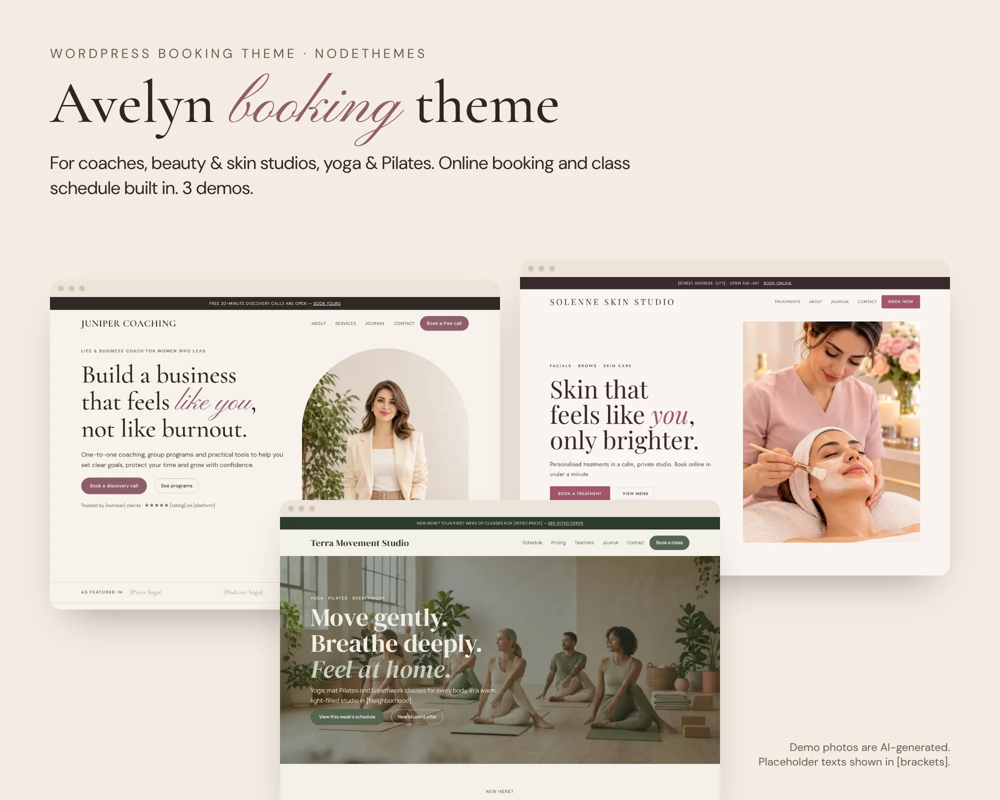
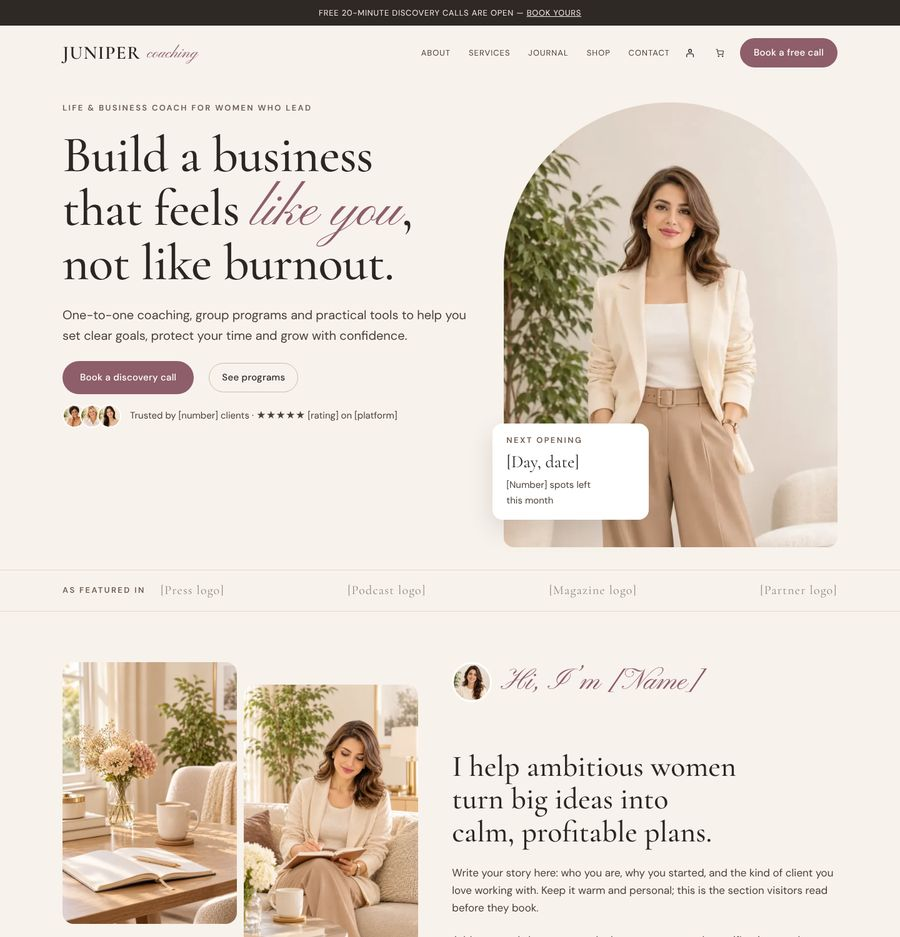
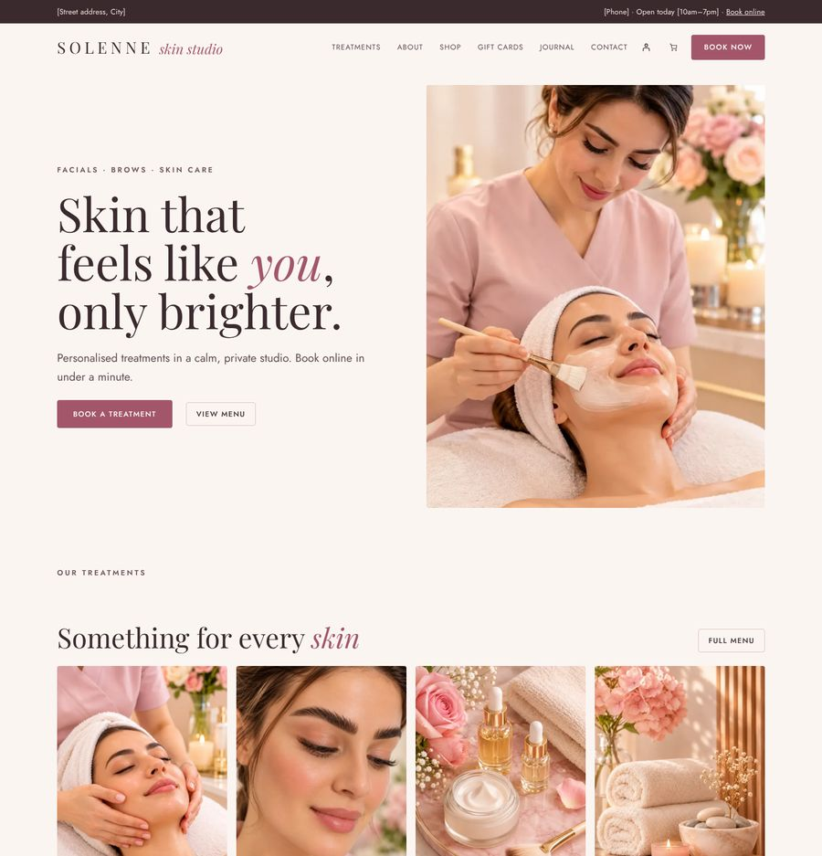
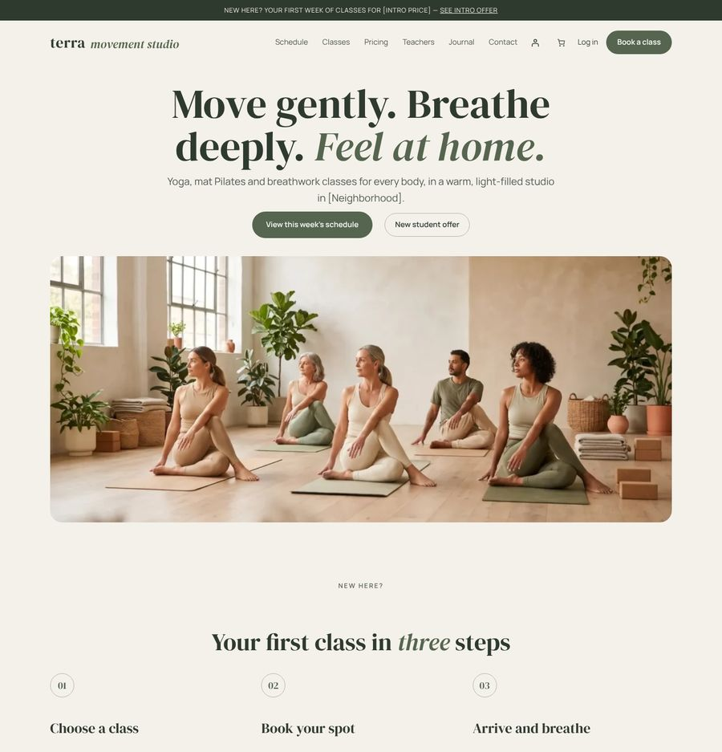
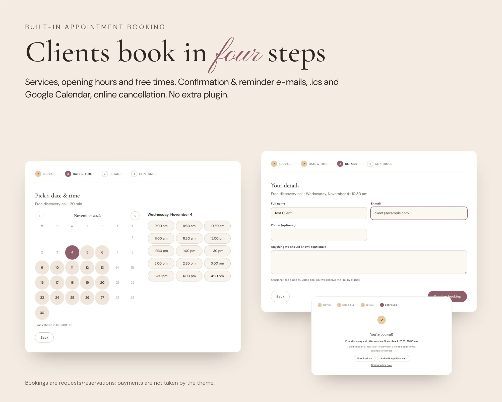
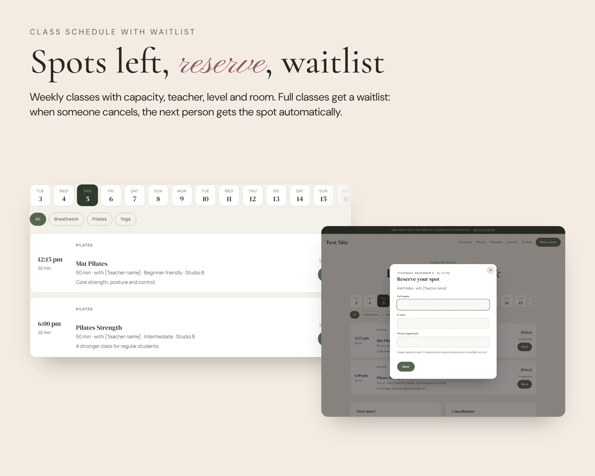
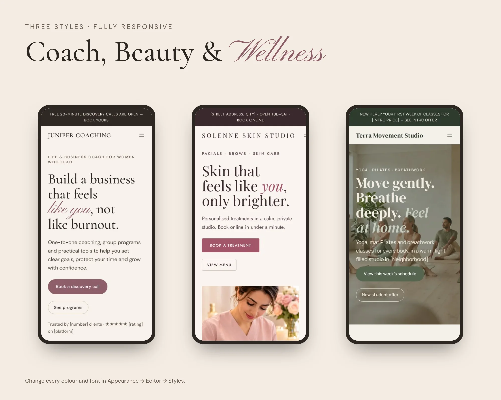
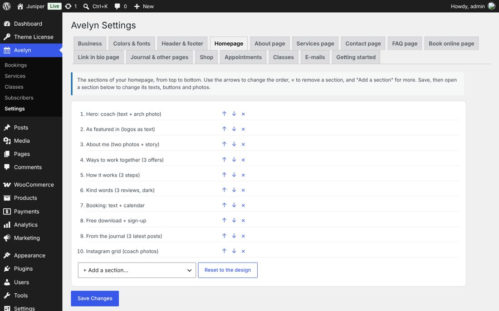

# Avelyn – booking WordPress theme for coaches & studios

**Online booking on WordPress for coaches, estheticians and yoga & Pilates studios: appointments, a class schedule with waitlist and three ready demos.**

Avelyn is a premium WordPress theme by [NodeThemes](https://nodethemes.com). Clients book a service and a free time, or reserve a spot in a weekly class, right on your own website. Everything is set in one settings panel: colors and fonts, header and footer, and the sections, texts and photos of every page.

> This repository is a **showcase**: it holds screenshots and information, not the theme code. The theme is sold at nodethemes.com with a yearly license that includes updates and support.

- **Website:** https://nodethemes.com/product/avelyn-booking-wordpress-theme/
- **Live demos:** [Coach](https://avelyn.nodethemes.com/) · [Skin studio](https://avelyn.nodethemes.com/skin/) · [Yoga studio](https://avelyn.nodethemes.com/yoga/)
- **Guide:** [Online booking on WordPress for coaches and studios](https://nodethemes.com/online-booking-wordpress-coaches-studios/)
- **Free WordPress plugins by NodeThemes:** https://nodethemes.com/free-plugins/

## Features

- **Appointment booking:** services with length, break after, price label and place; opening hours with a second range for breaks; closed dates; minimum notice; automatic or manual confirmation.
- **E-mails and calendars:** confirmation and reminder e-mails, an `.ics` calendar file, a Google Calendar link and online cancellation up to your limit.
- **Class schedule:** spots left, one reservation per e-mail address, an automatic waitlist and a "My bookings" list for visitors.
- **One settings panel (Avelyn → Settings):** 85+ sections you add, remove and reorder on every page, with every text, button and photo editable. Menus in Appearance → Menus.
- **Three styles and demos:** Coach, Skin studio and Yoga studio. Fonts are bundled (no Google Fonts).
- **Journal:** featured post, reading time, share links, author box and related posts.
- **Shop (optional, WooCommerce):** shop, product, cart, checkout and thank-you pages in the same design.
- **Also:** newsletter sign-up with CSV export, a contact form and spam protection on every public form.

Avelyn takes booking requests and class reservations; it does not charge for them. Sell packages, passes, courses or gift cards with WooCommerce.

## Screenshots

| Coach | Skin studio | Yoga studio |
|---|---|---|
|  |  |  |

## Requirements

WordPress 6.6 or newer, PHP 7.4 or newer. WooCommerce is optional (only for the shop).

## Support

- E-mail: nodethemes.com@gmail.com
- WhatsApp: +44 7441 429969
- Telegram: https://t.me/nodethemes

© NodeThemes. WordPress and WooCommerce are trademarks of their owners.
